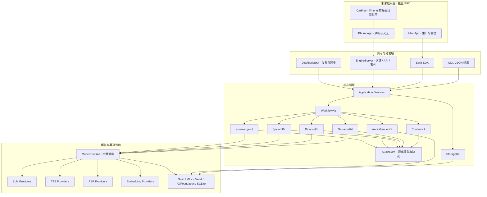
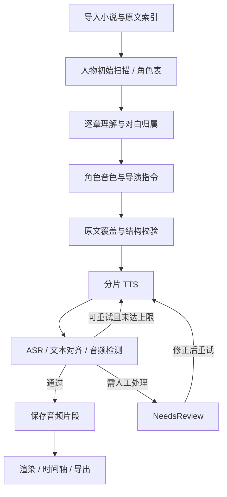
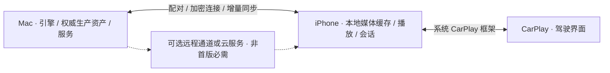

# Sonook（听澜）— 技术架构设计

> 文档版本：1.7（P6 Engine 1.0.0 发布基线）
> 更新日期：2026-11-26  
> 状态：P0–P5 已通过实测门禁。P6 Engine 1.0.0 的公开契约与文档已就绪，整合版发布验收见 [ADR-0007](docs/adr/0007-p6-engine-1-0-release.md)。性能数据见 [P0 基准报告](Benchmarks/p0-baseline.md)。
> 项目名称：**Sonook（听澜）**（Swift Package：`Sonook` · CLI：`sonook`）  
> 目标平台：Apple Silicon macOS；未来扩展 iPhone、CarPlay 客户端  
> 本文档是技术设计基线，不是 App PRD 或详细开发排期。

## 1. 项目愿景与范围

构建一个本地优先、面向 Apple Silicon 优化的原生 AI 音频引擎，将小说、剧本、个人知识和其他文本材料转化为可生产、管理、检索及交互的结构化音频内容。Mac 是主要计算和存储中心；未来以 Mac App 为生产管理入口，以 iPhone 和 CarPlay 为收听与交互入口。

### 1.1 已确定的产品与工程方向

- Engine First：先完成可独立运行的引擎，通过验证后开源，再设计和开发正式 App。
- 自主设计架构、领域模型和业务逻辑，不以 VoiceIt 的仓库作为主工程 Fork；可以借鉴成熟项目，并在许可证允许的情况下使用底层依赖。
- Apple Native First：核心引擎采用 Swift，优先使用 Apple Silicon、Metal/MLX 和原生音频框架。
- 首个旗舰工作流为中文长篇多人有声小说；随后扩展广播剧、私人播客与知识音频。
- 引擎应具备 CLI 和可供第三方调用的 SDK；正式 GUI 不属于引擎发布的前置条件。
- 未来 Mac、iPhone、CarPlay 的产品形态、体验和商业模式另行编写 PRD；当前仅确定职责和技术契约。

### 1.2 非目标

- 不自行训练基础 LLM、TTS、ASR 或重写 GPU 推理框架。
- 不追求首版覆盖所有模型、操作系统或音频编辑功能。
- 不要求 iPhone 首版运行完整生产引擎；不将 CarPlay 当作独立计算节点。
- 不要求首版搭建商业云平台、复杂实时协作系统或通用 Agent 框架。
- 不预设最终 GUI、商业定价、订阅方式及 App Store 发布时间。

### 1.3 决策状态约定

本文中「确定」表示用户已确认的总体方向；「建议」表示待工程评审的设计；「待验证」表示必须通过原型或实测才能定案。文中接口、目录、技术选型和验收数值均为建议基线，不代表已开发或实测。

## 2. 架构原则

| 原则 | 工程约束 |
|---|---|
| Engine First | 核心库与 UI、CLI、网络传输解耦 |
| Native First | Swift 为核心；优先使用原生模型与音频能力，允许隔离的非 Swift 模型服务作为可选后端 |
| Local First | 默认本地推理和存储，云端仅为显式授权的可选 Provider |
| Model Agnostic | 通过能力声明和统一接口接入可替换的模型 |
| Data First | 原文、角色、片段、音频、时间轴、来源均可追溯 |
| Workflow Driven | 长任务持久化、可恢复、可取消、可重试、可局部重新执行 |
| API First | CLI、SDK、未来 App 复用相同应用服务，不各自实现业务逻辑 |
| Offline First | 已下载节目无需 Mac 在线即可播放 |
| Privacy by Design | 私人资料、声音样本和生成内容默认不上传；服务默认仅绑定回环地址 |
| Progressive Complexity | 首版仅开发经过当前用例证明必要的抽象，不提前构建复杂平台 |

## 3. 总体架构



依赖规则：AudioCore 不依赖具体存储、模型框架、网络服务或 UI；具体 Provider 实现协议；WorkflowKit 通过应用服务和协议组织任务，不直接绑定模型实现。EngineCLI、EngineServer、未来 App 均为组合入口。共享跨设备的数据契约应放在不依赖 macOS 专属框架的 Swift Package target 中，便于 iOS 复用。禁止循环依赖。图为逻辑视图，不要求每个框都立即建成独立 Package。

## 4. 技术栈（建议）

| 层级 | 候选技术 | 注意事项 |
|---|---|---|
| 语言 / 并发 | Swift 6.x、Swift Concurrency、Actor | 检查 Sendable 与任务取消，隔离非线程安全模型对象 |
| 构建 | Swift Package Manager、Xcode / xcodebuild | P0 验证 Metal shader 和命令行打包；锁定可复现依赖版本 |
| LLM | MLX Swift LM | 首版只集成经过测试的一个中文模型；27B 是目标候选而非硬性依赖 |
| TTS / ASR | MLX Audio Swift、其他原生 Provider | 核查具体模型、中文表现、许可及接口成熟度；可选隔离进程作为兜底 |
| Audio DSP | AVFoundation、Accelerate | 优先原生拼接、重采样、响度处理、编码和渲染 |
| 存储 | 系统 SQLite3（WAL + 事务 + 顺序编号迁移 `v1 → v2 → v3 → v4 → v5`）、本地内容寻址文件资产 | P1–P5 零外部依赖落地（含书目/章节/审批/防剧透跨章记忆/音景计划/知识库 FTS5/播客计划/发行版本/配对设备/离线同步与交互会话表，见 [ADR-0002](docs/adr/0002-p1-storage-workflow-runtime.md)–[ADR-0006](docs/adr/0006-p5-server-distribution-and-sync.md)）；大音频与权重隔离存放 |
| 检索 | SQLite FTS5 + CJK 双字混合检索（已于 P4 `KnowledgeKit` 落地）；后续可选 Embedding 检索 | 已覆盖中英文混合检索、字节偏移引用溯源、事实/推断区分与双层防剧透上下文查询 |
| CLI | 原生 Swift CLI（人机双用；POSIX stdout `--json` 净输出、退出码、stderr 日志） | 已覆盖 P1–P5 完整命令集 |
| 网络 | Apple Network.framework + Swift Concurrency（零外部依赖，已于 P5 `EngineServer` 落地） | 默认 `127.0.0.1` 回环监听、配对认证、Range 断点下载与 SSE 事件流；Bonjour 局域网发现留 App 阶段 |
| 日志与测试 | OSLog / SwiftLog、Swift Testing / XCTest | 包含性能、真实模型与故障注入测试 |
| 后续 GUI | SwiftUI；必要时使用平台原生框架 | GUI 不进入引擎依赖链 |

参考上游： [MLX Swift](https://github.com/ml-explore/mlx-swift)、[MLX Swift LM](https://github.com/ml-explore/mlx-swift-lm)、[MLX Audio Swift](https://github.com/Neywa-Labs/mlx-audio-swift)、[VoiceIt](https://github.com/Tapnetix/VoiceIt)、[AgentSkillDeck](https://github.com/AgentSkillDeck/skills)。后两者仅为设计和工作流参考，不构成必需依赖。本版本实际采用的包、锁定版本与许可见[第三方许可审计](docs/THIRD_PARTY_LICENSES.md)。

## 5. 模块与职责

| 模块 | 职责 | 最早实现阶段 |
|---|---|---|
| AudioCore | 领域对象、ID、版本、错误类型、通用协议 | P1 |
| StorageKit | 持久化、迁移、事务、文件资产、缓存与仓储实现 | P1 |
| ModelRuntime | 模型注册、下载校验、加载卸载、推理适配与内存调度 | P0/P1 |
| ContentKit | TXT/Markdown/EPUB 导入、章节划分、文本规范化、原文映射 | P2 |
| NarrativeKit | 人物识别、别名合并、对白归属、人物关系和章节记忆 | P2/P3 |
| DirectorKit | 结构化剧本、音色分配、情绪、语速、停顿、音效提示 | P2 |
| SpeechKit | TTS、音色管理、声音克隆、ASR 质检、局部重生成 | P0/P2/P3 |
| AudioRenderKit | 拼接、重采样、响度、时间轴、混音、导出 | P2/P4 |
| WorkflowKit | 持久化 DAG、任务执行、依赖、重试、取消、缓存、恢复 | P1/P3 |
| KnowledgeKit | 私人知识检索、证据、播客脚本、按播放位置检索 | P4 |
| DistributionKit | 版本化音频包、增量清单、发布、同步与播放事件 | P5 |
| EngineSDK | 面向调用方的稳定应用服务 API | P1/P6 |
| EngineCLI | 命令行、脚本调用、结构化输出；可选 TUI/Skill | P1/P6 |
| EngineServer | 本机服务、设备授权、内容交付、任务事件与交互接口 | P5 |

模块名称暂定。P0 只建设最小技术实验，不要求提前实现全部模块。P1 首先固定关键契约并建立垂直切片，避免空壳架构。

## 6. 模型运行时与调度

### 6.1 Provider 契约

```swift
// 概念接口，非可独立编译的实现。
public protocol LLMProvider: Sendable {
    var capabilities: LLMCapabilities { get }
    func generate(_ request: LLMRequest) async throws -> LLMResponse
}
public protocol TTSProvider: Sendable {
    var capabilities: TTSCapabilities { get }
    func synthesize(_ request: SpeechRequest) async throws -> AudioArtifact
}
public protocol ASRProvider: Sendable {
    var capabilities: ASRCapabilities { get }
    func transcribe(_ request: ASRRequest) async throws -> Transcript
}
```

正式接口补充模型生命周期、流式生成、取消、超时、错误分类、版本与可观测性。能力注册表声明支持语言、音色克隆、情绪指令、采样率、上下文长度及流式能力；不支持的参数必须显式拒绝或记录降级，不能静默忽略。

模型注册记录来源、模型标识、固定版本/权重哈希、量化类型、运行时、许可、预估资源与实测数据。每次生成记录实际 Provider、模型版本、配置及 Prompt 版本；模型下载应支持校验及用户选择，不默认下载大权重。

### 6.2 Apple Silicon 资源管理

- ResourceManager 统一管理模型租约、模型加载/卸载和推理并发，考虑系统及其他进程占用；不能仅凭模型文件大小估算峰值内存。
- 批量生产优先按阶段运行：LLM 生成剧本 → 释放或缩减驻留 → TTS 合成 → ASR 批量质检 → 针对失败片段再次合成。减少模型切换开销。
- 当内存预算允许时可以保留多个模型；压力升高时停止新增任务、释放缓存、降并发或暂停。
- 实时交互任务优先级高于后台生产；在安全片段边界让出资源。硬件无法满足时显式降级，不保证任意请求均能立即抢占 GPU。
- 记录加载耗时、峰值内存、吞吐、温度/热压力和失败原因。针对实际设备建立性能档位，而不是写死 64GB / 128GB 参数。
- P0 验证 M 系列设备上 Swift 原生 LLM/TTS/ASR、中文语音质量、长时运行、模型交替释放与内存峰值；失败时允许隔离 Provider 服务，不改变引擎领域接口。

## 7. 核心领域模型与持久化

| 实体 | 内容与约束 |
|---|---|
| Project | 小说、播客栏目、广播剧等独立生产空间 |
| SourceDocument | 不可变原始版本、文件哈希、来源及导入配置 |
| Chapter | 顺序、原文范围、标题和解析版本 |
| Character | 稳定角色 ID、别名、身份及角色关系 |
| CharacterMemory | 人物状态、证据、可获知的章节及原文位置 |
| VoiceProfile | 音色 ID、Provider、模型、参考素材及生成参数版本 |
| Script | 剧本版本、制作模式、所属来源 |
| Segment | 最小生成/质检/替换单元；原文、实际朗读文本、角色与指令 |
| AudioArtifact | 音频文件哈希、格式、时长、采样率、生成来源和版本 |
| QualityReport | ASR 转录、对齐、错误类型、人工审核与重试记录 |
| Timeline | 各轨道、片段、实际渲染后时间与文本的映射 |
| Episode | 可发布的章节或节目及发布版本 |
| Job | 执行 DAG、节点状态、依赖、重试、检查点及错误 |
| PlaybackSession | 节目版本、位置、播放事件、设备与会话状态 |
| Interaction | 问题、回答、引用、关联播放位置及恢复锚点 |

### 7.1 Segment 数据契约（示例）

```json
{
  "schema_version": 1,
  "segment_id": "seg_000128",
  "chapter_id": "ch_003",
  "source_document_revision": "doc_rev_1",
  "source_span": {"unit": "utf8_byte", "start": 1820, "end_exclusive": 1844},
  "source_text": "你终于回来了。",
  "spoken_text": "你终于回来了。",
  "speaker_id": "char_007",
  "voice_profile_revision": "voice_007_rev_1",
  "direction": {"emotion": "restrained_relief", "rate": 0.92, "pause_after_ms": 500},
  "script_revision": 1,
  "audio_artifact_id": null,
  "status": "pending"
}
```

上述偏移为说明性占位，实际应由导入器生成并校验，范围针对指定不可变的规范化原文版本。统一使用半开区间和明确的偏移单位；不得混用 Swift String.Index、UTF-16 和 UTF-8。音频时间轴建议使用整数采样帧并附采样率，向 API 暴露统一时间单位。原文模式的 `spoken_text` 仅允许可审计的朗读规范化（如数字发音），不得未经授权改写剧情。

### 7.2 存储与版本策略

SQLite 保存项目、关系、任务、版本、索引；文件系统保存原文、音频、参考素材、权重。模型缓存与项目资产隔离。音频先写临时文件，校验后原子移动，再提交数据库引用；启动时回收孤立文件和恢复中断任务。禁止直接同步正在使用的 SQLite 数据库。

缓存键包含输入内容哈希、角色/音色版本、Provider 与模型权重版本、参数、Prompt/处理器版本等必要因素。修改片段触发最小范围失效；发布版本不可变，替换内容产生新版本。音频重新渲染后必须重新生成对应时间轴。

## 8. 内容生产工作流

### 8.1 多角色有声小说（首个垂直切片）



角色状态依赖章节顺序；全书扫描可用于统一角色 ID，但不得将未来剧情泄露给当前播放位置的问答检索。对白归属记录置信度和证据；低置信度可按策略交给人工确认。确认后的角色声线稳定绑定 VoiceProfile 版本。ASR 质检结合字符错误率、漏读、重复、异常静音、音频完整性；ASR 不是绝对真值，保留试听与手动修正入口。

### 8.2 广播剧与私人播客（P4）

| 制作模式 | 原文保真有声书 | 广播剧 | 私人播客 |
|---|---|---|---|
| 输入 | 小说 | 小说/剧本 | 兴趣、知识库、资料 |
| 文本规则 | 保留原文 | 明确允许改编 | 可生成剧本，保留证据与引用 |
| 导演 | 旁白、人物、语气 | 场景、音效、多轨 | 单人讲解或多人讨论 |
| 共享步骤 | 角色/声音、分片 TTS、质检、渲染、发布 | 同左 | 同左 |

广播剧在显式授权后改编；播客保留引用与时间，并区分事实与推断。三种制作模式复用同一套生成、质检与导出流程。

## 9. 工作流可靠性与执行语义

采用持久化 DAG 与 Actor 调度器。章节理解可有顺序依赖；仅在剧本、角色和音色版本确定后并行合成片段；最终渲染依赖所有必要片段通过质检或获得显式人工批准。

任务状态：`Pending -> Ready -> Running -> Verifying -> Completed`，异常分支为 `Retrying / Paused / Failed / Cancelled / NeedsReview`。不需要质检的任务可从 Running 直接完成。任务租约与心跳识别进程中断，恢复时重新领取未提交的节点。重试须有次数上限、退避和错误分类；不可重试错误直接进入失败或人工审核。取消以安全检查点为边界，已生成并验证的资产不因取消被删除。

必须支持：幂等执行、检查点、断点恢复、局部重新生成、缓存失效、优先级、可追溯日志与故障注入测试。数据库和文件之间不能假设跨介质原子事务，需定义恢复与清理流程。长任务默认无需 GUI 常驻，但实际运行仍受系统休眠、退出和权限限制。

## 10. CLI、SDK 与服务边界

CLI 作为引擎第一使用入口；业务逻辑集中在 SDK/Application Services。所有关键命令支持 `--json`，进度/日志写 stderr，错误有稳定退出码；非交互模式不得阻塞等待用户输入。

```bash
# 常用 CLI 入口。完整参数见 sonook help，安装和一键制作见 README。
sonook doctor
sonook model list
sonook model register --id <id> --kind <kind> --provider <provider> --path <local-dir>
sonook project create --type audiobook --name <name>
sonook project path <id>
sonook import ./novel.epub --project <id>
sonook analyze --project <id>
sonook memory list --project <id> [--up-to <n>]
sonook character list --project <id>
sonook character export-md --project <id>
sonook generate --project <id> --run [--max-repair-rounds 2]
sonook job list
sonook job resume <job-id>
sonook review list --project <id>
sonook review reassign <segment-id> --project <id> --speaker <name>
sonook review approve-all --project <id> --max-cer 0.05 --note "..."
sonook cache plan --project <id>
sonook segment regenerate <segment-id> --project <id>
sonook verify --project <id> [--save-report]
sonook export --project <id> --format m4b
sonook serve --host 127.0.0.1
```

### 10.1 CLI 本地工作区目录与文件命名规范（已确定）

CLI 默认将工作区建在用户主目录可见路径 `~/Sonook`（解析优先级：`--workspace <dir>` > `SONOOK_WORKSPACE` 环境变量 > `~/Sonook`），将「人类直接查看的成品目录 `outputs/`」与「引擎内部内容寻址资产 `assets/`」明确隔离（实现契约见 `AudioCore/WorkspaceLayout.swift`）：

```text
~/Sonook/
├── sonook.sqlite                              # 引擎数据库（项目、书目、章节、剧本、任务断点、资产索引）
├── outputs/                                   # 用户成品目录（Finder 直接可见，按书归档）
│   └── <安全书名>__<projectID>/                # 清洗路径非法字符，保留中文可读性，附 ID 防重名
│       ├── audiobooks/                        # sonook export 省略 --out 时的默认输出目录
│       │   ├── <书名>_<章节范围>_<音轨模式>.m4b
│       │   └── <书名>_<章节范围>_<音轨模式>.timeline.json
│       ├── characters/                        # sonook character export-md 省略 --out 时的默认目录
│       │   └── characters.voice-cards.md
│       ├── releases/                          # 带版本的 .audiopack 目录
│       └── reports/                           # sonook verify --save-report 的默认输出目录
│           └── verify_<章节范围>.json
├── assets/                                    # 引擎内部不可变内容寻址素材（<kind>/<sha256>.<ext>，勿手改）
└── .tmp/                                      # 原子写入临时目录（doctor 启动自动清理）
```

- **章节范围命名**：单章 `ch001`、连续多章 `ch001-002`、整书 `full`、非连续多章 `ch001+003`。
- **音轨模式命名**：纯人声 `dry`（默认）、手动环境音 `ambient`、剧情场景音景 `soundscape`（P4 落地）。
- **快捷定位**：`sonook project list` 直接展示每个项目的 `outputs/` 路径；`sonook project path <project-id>` 输出项目成品目录路径（支持 `--json`）。

EngineServer 通过版本化 HTTP/1.1 和 SSE 提供项目与发行清单、受限媒体下载、任务查询、播放进度和防剧透问答。客户端按已注册的发行 ID 与相对路径下载。

## 11. 跨设备协同架构（App 前置契约）



| 场景 | 设计行为 |
|---|---|
| 同一局域网 | Bonjour 发现、用户确认配对、认证连接；浏览/下载音频、提交任务、同步播放 |
| 离线通勤 | iPhone 从本地缓存播放，记录事件，Mac 可以关机；问答仅限已有本地能力或提示不可用 |
| 异地联网 | 可选安全私有网络/中继访问在线 Mac；远程推理依赖 Mac 可达且保持运行 |
| 可选云端 | 明确授权后才上传指定上下文；不默认同步私人原文、音色或完整知识库 |

### 11.1 同步协议

- Mac 负责权威生产项目、原始音频、角色与发布版本；iPhone 负责本地播放、下载及离线播放事件；CarPlay 通过 iPhone 使用同一会话。
- 采用稳定 ID、版本化清单、内容哈希、增量下载和校验。媒体可分章下载，支持恢复及存储配额。节目更新时保留原播放版本，必要时通过片段 ID 映射位置，不能仅靠旧时间戳迁移。
- 播放事件含唯一事件 ID、设备 ID、节目版本、位置、事件类型及设备序列；支持重复提交去重。主动回退/重听不得被「取最大进度」覆盖。跨设备并发播放冲突策略需在 App PRD 和同步原型中确定。
- 第一阶段仅验证局域网配对、媒体下载、离线状态及测试客户端同步；无需建设商业云后端。CloudKit 可作为后续元数据同步候选，但不能作为实时 RPC。
- 局域网发现不等于可信身份；必须进行显式配对、可撤销凭据、传输加密和最小权限授权。默认回环监听，禁止未经授权暴露公网。
- iOS 本地网络权限、后台下载和音频会话需真机验证，后台调度不保证立即执行；Mac 休眠或关机时远程推理不可用。

### 11.2 开放内容发布格式

Engine 1.0.0 采用版本化目录与 JSON。字段、时间单位、隐私边界、校验及同步规则见[开放格式规范](docs/specs/audiopack-v1.md)。

```text
Example.audiopack/
├── manifest.json
├── metadata.json
├── artwork.jpg       # 可选
├── chapters/001.m4a
├── transcripts/001.json
├── characters.json
├── timeline.json
├── references.json   # 可选
└── checksums.json
```

清单包含格式版本、节目及发布版本 ID、章节顺序、音频时长、文件大小、哈希、必要/可选文件与所需能力。校验未知版本、路径遍历和文件大小上限。默认不打包模型、密钥、原始声音克隆样本或未获授权的私人原文。标准 M4A/M4B/WAV 可以单独导出。原生 M4B 章节写入与回读记录见 [ADR-0003](docs/adr/0003-p2-audiobook-mvp.md)。

## 12. 为交互式音频预留的技术能力

未来流程：暂停原节目并保存恢复锚点 → ASR 转录问题 → Context Resolver 根据节目版本及时间轴提取当前段落 → LLM/RAG 回答 → 流式 TTS 播放 → 恢复原节目。

Context Resolver 必须在检索层实行防剧透过滤：小说问答只查询当前播放位置之前可获知的证据。全书角色表、未来情节摘要、缓存与模型上下文均不得绕过过滤；如果用户明确要求剧透，才切换检索范围。模型常识可能泄露已知作品情节，因此还需输出检查及相关测试，不能保证仅凭检索过滤完全消除剧透。

交互会话与原播放会话分离，保留恢复锚点和取消状态。首版引擎可只提供上下文查询接口、独立交互任务和测试样例，完整实时语音 UI 交给 App 阶段。

CarPlay 不是独立 App 运行环境。音频播放路径、模板、entitlement、麦克风访问以及驾驶场景语音对话限制均需要按照当时 Apple 的政策另行验证，不能承诺任意对话能力可直接在 CarPlay 中上线。

## 13. 安全、隐私与许可

- 受保护的 API 检查配对设备与权限。服务端保存配对码与令牌的 SHA-256 摘要，支持撤销；客户端负责安全保存令牌。详见[安全指南](SECURITY.md)。
- 所有导入内容视为不可信数据。小说文本、播客资料及 RAG 结果中的指令不得被当作系统命令；解析器限制大小和路径，LLM 不直接获得任意系统执行权限。
- 使用云端 Provider 前明确告知数据范围及目的，并提供本地处理路径；用户可删除项目、缓存、模型和关联声音样本。
- 声音克隆仅使用拥有适当授权的素材。记录权利、来源及删除机制；模型许可、音效素材许可、依赖许可和引擎代码许可证独立审查。
- 引擎代码采用 [Apache-2.0](LICENSE)。SwiftPM 依赖、Apple SDK、用户下载的模型与外部音效各自适用的条款见[第三方许可清单](docs/THIRD_PARTY_LICENSES.md)。

## 14. 建议工程结构

```text
sonook/
├── Package.swift
├── Sources/
│   ├── AudioCore/
│   ├── StorageKit/
│   ├── ModelRuntime/
│   ├── ContentKit/
│   ├── NarrativeKit/
│   ├── DirectorKit/
│   ├── SpeechKit/
│   ├── AudioRenderKit/
│   ├── WorkflowKit/
│   ├── KnowledgeKit/
│   ├── DistributionKit/
│   ├── EngineSDK/
│   ├── EngineServer/
│   └── SonookCLI/
├── Tests/                  # Unit / Integration / EndToEnd / Performance / Fixtures
├── Schemas/                # JSON Schema 与迁移说明
├── Workflows/              # 工作流定义；是否采用 YAML 待评审
├── Prompts/                # 版本化提示词
├── Skills/                 # 后续 Agent 入口
├── Examples/
├── Benchmarks/
├── docs/
│   ├── adr/
│   ├── api/
│   └── providers/
├── .github/workflows/
├── ARCHITECTURE.md
├── ROADMAP.md
├── SECURITY.md
├── NOTICE
├── README.md
├── LICENSE
└── CONTRIBUTING.md
```

采用 Monorepo，按依赖实际出现时逐步增加 target，不预建大量空模块。未来 App 是否同仓维护由产品阶段决定；引擎的公共 SDK、API 和格式契约不得依赖私有 App 源码。

## 15. 阶段依赖与验收门槛（非排期）

| 阶段 | 主要交付 | Gate / 进入下一阶段的条件 |
|---|---|---|
| P0 技术验证 | 原生 Swift 推理实验、中文 LLM/TTS/ASR、资源基准 | 独立运行三个后端并生成、质检最小多角色样例；记录失败及兜底路径 |
| P1 引擎基建 | 领域模型、存储、Provider、资源管理、CLI、持久化任务 | 假模型及真实模型任务可执行、恢复和诊断 |
| P2 有声书 MVP | TXT/EPUB 导入、人物/对白、选声、分片 TTS、基础渲染 | 自动生成完整短篇多人小说并导出；原文映射可验证 |
| P3 长篇可靠性 | 跨章记忆、ASR 质检、重试、缓存、断点恢复 | 代表性长篇压力测试及故障注入通过，向百万字目标推进 |
| P4 通用音频 | 广播剧、混音、私人播客、RAG 与证据 | 至少两种内容类型共享生产工作流 |
| P5 服务与协同 | 本地 API、认证、音频包、同步和上下文接口 | 测试客户端完成下载、离线播放状态及重连同步；不要求正式 App |
| P6 Engine 1.0 | 1.0.0 公开契约与开源文档已就绪 | 整合版通过安装、生产、卸载和全树脱敏后可对外发布 |
| P7 App 产品设计 | 独立 PRD、设备协同体验、原型与商业策略 | 产品与技术评审完成后才进入正式 App 开发 |

具体任务、工时、负责人及发布版本由 ROADMAP.md 或后续项目管理系统维护。P4/P5 范围可在开源前评审裁剪；不要让未来 App 的需求阻塞可独立使用的早期开源版本。

## 16. 测试与 Benchmark

测试分为纯逻辑单元测试、契约测试（Fake Provider）、集成测试、真实模型测试、端到端、故障注入及性能基准。使用有权使用的中文测试语料，覆盖多角色、无引号对白、别名、长章、数字/多音字、中英混合、旁白及复杂叙事。

| 指标 | V1.0 建议目标 / 评价方法 |
|---|---|
| 原文结构覆盖率 | 100%；每个原文范围有明确保留或授权处理记录 |
| 对白归属准确率 | ≥95%；人工标注测试集，按章节与困难类别分层 |
| 中文字符错误率 CER | ≤2%；预先定义文本规范化规则，结合人工试听 |
| 角色一致性 | 固定 VoiceProfile 版本；人工盲听与可选音色相似度指标 |
| 自然度/情绪 | MOS、情绪匹配及可懂度人工评价 |
| TTS 实时因子 RTF | 目标 ≤1；注明设备、模型、量化、并发及是否计入加载耗时 |
| 长时运行 | ≥24 小时压力测试；无不可恢复崩溃 |
| 异常恢复 | 已成功提交且未失效的片段 100% 保留；验证强制退出与磁盘异常 |
| 内存 | 峰值与压力事件，记录不同阶段模型驻留、切换及资源占用 |
| 交互延迟 | 分别记录 ASR、LLM 首 Token、TTS 首音频与端到端 P50/P95 |
| 防剧透 | 人工构造跨章问题、未来情节诱导、缓存污染等测试 |
| 跨设备 | 哈希一致性、重复事件去重、断网、重连、版本冲突 |

这些指标是候选工程目标，不是模型实测值或性能承诺。P0 必须先建立基线，再确定目标硬件档位及最终发布阈值。长篇测试需同时衡量速度、质量、磁盘增长和重试成本，不只统计成功率。

## 17. 开源边界与发布标准

引擎应提供真正独立价值：CLI/SDK、模型适配、音频生产、工作流与质检、开放数据格式、本地服务及基础同步接口。未来商业 App 提供原生图形体验、便捷安装、跨设备体验、智能内容订阅、播放管理和交互设计。商业策略另行决定，不通过锁死底层格式制造依赖。

开源发布检查：可复现构建、明确的支持平台/模型、安装及卸载步骤、样例、许可证与依赖审计、数据迁移策略、API/Schema 版本、已知限制、性能基准、贡献指南和安全报告渠道。核心 API 采用语义化版本管理；不稳定接口标记为实验性。

## 18. 架构红线

1. 核心引擎不得依赖 SwiftUI、AppKit、UIKit 或 CarPlay。
2. 模型接入必须使用 Provider 契约，禁止业务模块直接绑定某一模型框架。
3. 长时间任务必须具备持久化、取消与恢复能力。
4. 音频必须可追溯原文、角色、剧本与模型版本；局部重生成不破坏其他合格资产。
5. 数据格式和公开接口必须有版本；迁移须经测试。
6. 网络服务默认回环监听，远程访问必须认证与授权。
7. 私人数据默认不上传；不得因模型降级静默切换到云端。
8. 非确定性模型输出必须经过结构校验和必要质检；保留失败及人工审核状态。
9. 新功能必须有相应测试；重大架构变动须记录 ADR。
10. 不提前开发正式 App，也不为未经验证的未来功能建立复杂基础设施。

## 19. 待验证事项与下一步

| 待决策 / 风险 | 验证方式 | 时点 | 当前状态（2026-11-26） |
|---|---|---|---|
| 原生 Swift 模型库成熟度、模型兼容性与许可证 | 真实编译、中文样例、依赖审计 | P0 | **已验证**（[ADR-0001](docs/adr/0001-p0-native-mlx-runtime.md)：`mlx-swift-lm` + `mlx-audio-swift` 单包无冲突、MIT 许可、安装 MetalToolchain 后纯 `swift build` 原生编译 shader） |
| 27B 或其他 LLM 的内存及长篇理解能力 | 多模型基准、角色归属和内存测试 | P0/P2 | **P2 已通过确定性 9B 验收**（[ADR-0003](docs/adr/0003-p2-audiobook-mvp.md)：M5 Max 64GB 上 `Qwen3.5-9B` 峰值 5.53 GiB / 5,667 MiB，锁定 `temperature=0.0, seed=42` 冷启动 100% 一致，配合 `DialogueAttributionValidator` 呼语与双人交替规则第 1 章对白归属全部准确；`Qwen3.8-27B` 峰值 15.43 GiB 保留作长篇高精度档） |
| TTS 中文自然度、克隆、情绪及 RTF | 同一测试集盲听与性能对照 | P0/P2 | **已验证并落地 P2 生产管线**（`Qwen3-VoiceDesign` 定妆不可变音色锚点 + `VoxCPM2-8bit` 48 kHz 锁定合成，P2 多章真机实测 RTF 0.21–0.23 / 物理峰值 9,238 MiB / Apache-2.0，并支持跨章 `VoiceDeliveryStage` 成长演绎基线） |
| LLM/TTS/ASR 资源切换及峰值内存 | 长时运行与内存压力实测 | P0/P3 | **P3 已通过 5 连续章节（97 段）真机压测与 `SIGKILL` 强杀恢复验收**（[ADR-0004](docs/adr/0004-p3-long-form-reliability.md)：5 章实测峰值 `9B 5,623 MiB · VoiceDesign 10,784 MiB · VoxCPM2 10,332 MiB · ASR 4,305 MiB`，收尾热状态 `nominal`，100 章 / 1,500 段自动化故障注入压测 2.07s 通过） |
| ASR 质检的误报漏报 | 人工标注音频与混淆分析 | P2/P3 | **P3 已落地后置分批自动换 Seed 修复 + 批量 `NeedsReview` 审核流**（[ADR-0004](docs/adr/0004-p3-long-form-reliability.md)：在 P2 声调拼音专词豁免之上新增 2 轮零模型抖动自动修复与最佳候选择优，真机自动修好 1 声错读并保护更优片段；`sonook review` 支持列表/重试/改派说话人/阈值批审） |
| 章节记忆和防剧透 | 长篇测试集与跨章节检索评估 | P3–P5 | **P3–P5 已落地 SQLite `v3→v5` 防剧透记忆 + `KnowledgeKit` + `SpoilerSafeContextResolver` 双层防剧透**（[ADR-0004](docs/adr/0004-p3-long-form-reliability.md)–[ADR-0006](docs/adr/0006-p5-server-distribution-and-sync.md)：M5 Max 真 9B 在第 2 章诱导提问第 4 章人物时成功截断未来 1,029 章并触发输出防泄露守卫，显式 `--allow-spoilers` 后正常解锁） |
| 原生编码及 M4B / `.audiopack` 兼容性 | 真实播放器与开放包校验 | P2–P5 | **P2–P5 已通过原生多章干声/多轨剧情音景 `.m4b` 与 `.audiopack`（`format_version=1`）验收**（5 章 11.15 MB 发行包 14 份文件 SHA-256 校验通过、脱敏无声音克隆样本，支持 HTTP `Range` 206 分章续传） |
| 本地服务配对、认证与断点下载 | 测试客户端与回环服务 | P5 | **P5 已在 `EngineServer` 落地并经 8 项实时客户端检查验收**（[ADR-0006](docs/adr/0006-p5-server-distribution-and-sync.md)：默认 `127.0.0.1`、禁止明文 LAN 绑定、单次配对码 + 可撤销最小权限 Bearer 令牌、Range 206 续传与 SSE 事件流；iOS 真机后台传输与 Bonjour 发现留 P7 App 阶段） |
| 设备冲突与离线进度同步 | 事件重放及冲突用例 | P5/P7 | **P5 已落地 `PlaybackSyncEngine` 并在实时服务验收通过**（`(device_id, event_id)` 100% 幂等去重、保护 `.rewind`/向后 `.seek` 不被 `max(position)` 覆盖、支持跨发行版本按 `segmentID` 精准迁移进度；多端并发冲突 UI 策略留 P7 App PRD） |
| CarPlay 授权及交互限制 | 核查当期 Apple 文档，真机与申请路径验证 | P7 | 待验证 |
| 开源许可证及商业边界 | 锁文件与上游许可核对 | P6 | 引擎已采用 Apache-2.0，开放格式与模型、音效和第三方许可审计已就绪。详见 [ADR-0007](docs/adr/0007-p6-engine-1-0-release.md)。 |

P7 的 Mac、iPhone 和 CarPlay 产品设计单独开展。Engine 1.0.0 的集成验收与发布状态由[路线图](ROADMAP.md)和 [ADR-0007](docs/adr/0007-p6-engine-1-0-release.md)跟踪。

---

**架构结论：** 自主设计原生核心引擎，以结构化音频和持久化工作流作为长期资产，通过可替换模型适配器获取 AI 能力。先让引擎独立可用、可测、可扩展并开源，再建设以 Mac 为生产中心、iPhone 为移动终端、CarPlay 为驾驶场景延伸的商业应用体系。
