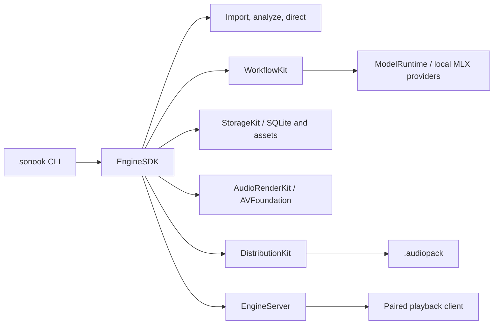

# Sonook CLI (听澜)

[简体中文](README.zh-CN.md)

[](https://github.com/KrakenP/Sonook-CLI/actions/workflows/ci.yml) [](LICENSE)  

Turn a manuscript into a cast of voices from your Mac terminal. **Sonook CLI (`sonook`)** is a local-first, Apple Silicon-native Swift command-line tool and audio engine. It follows each passage from its original text through speaker assignment, synthesis and quality review to a chaptered audiobook. If a line needs another take, you can regenerate that line and keep the rest of the recording.

## What you can make

- **Verbatim audiobooks.** Import TXT, Markdown or EPUB. Lock a voice for each character, check readings with local ASR and export M4B with chapter markers, M4A or WAV.
- **Story-aware soundscapes.** Place ambience and foley against scene and segment cues. Mix a local sound library under the voices while keeping the dry recordings for later edits.
- **Authorized audio drama.** Give explicit adaptation permission for a project. Adapt dialogue and narration into a script that retains source-byte references.
- **Private podcasts.** Ingest local notes, plan a solo or two-host episode, and trace statements and inferences to cited excerpts.
- **Offline distribution and sync.** Publish a chapter-addressable `.audiopack`. A loopback server offers pairing, resumable downloads, playback sync and context queries bounded by the listener's progress.



The CLI calls the same application services available to Swift clients. AudioCore defines shared contracts. ModelRuntime loads providers in stages, and WorkflowKit checkpoints work between segments. [Architecture](ARCHITECTURE.md)

## Measured on Apple Silicon

Apple M5 Max, 64 GiB unified memory. RTF is synthesis time divided by generated audio duration. The stress test below measures scheduling, persistence and recovery with fixture audio.

| Measurement | Result |
|---|---|
| 48 kHz VoxCPM2-8bit with a locked reference voice, 20 segments | Steady-state RTF **0.219** (4.57× real time). MLX peak **7.46 GiB**, peak process footprint **9.50 GiB**. [P0 benchmark](Benchmarks/p0-baseline.md) |
| Five chapters, 97 segments, real GPU generation | RTF **0.21–0.24**. Peak process footprints were Qwen3.5-9B **5,623 MiB**, VoiceDesign **10,784 MiB**, VoxCPM2 **10,332 MiB**, ASR **4,305 MiB**. [Long-form gate](docs/adr/0004-p3-long-form-reliability.md) |
| Recovery from `SIGKILL` during GPU inference | Restart skipped all **8** committed checkpoints. **0** missing, corrupt or orphaned assets. [Recovery run](docs/adr/0004-p3-long-form-reliability.md) |
| 100 chapters / 1,500 segments, four injected retries | **2.070 s** including cancellation after 400 checkpoints and reopening the workspace. All 1,500 WAV hashes verified. [Stress test](docs/adr/0004-p3-long-form-reliability.md) |
| Published test baseline | **175 unit tests** across 11 targets, plus **8** live loopback client checks. [P5 acceptance](docs/adr/0006-p5-server-distribution-and-sync.md) |

## Install and make your first chapter

Use an Apple Silicon Mac, macOS 14 or later and a full Xcode installation that provides Swift 6.3 or later and the Metal Toolchain. Run these commands from the root of a **1.0 release checkout**. SwiftPM fetches the pinned build dependencies on first build.

```sh
git clone https://github.com/KrakenP/Sonook-CLI.git
cd Sonook-CLI
xcodebuild -downloadComponent MetalToolchain
./scripts/install.sh
export PATH="$HOME/.local/bin:$PATH"
sonook --version
sonook doctor
```

Add the PATH line to your shell profile for future sessions. The default prefix is `~/.local`. Use `./scripts/install.sh --prefix <dir>` for a different location. To uninstall, run `./scripts/uninstall.sh` with the same prefix. A normal uninstall preserves your workspace, exports and local weights.

For a development checkout, run `swift build -c release` and `export PATH="$PWD/.build/release:$PATH"` to use the CLI in place. The individual production commands below also work on a checkout that predates the installer.

Download MLX-compatible weights for the four stages, then point the following commands at the actual directories on your machine. Each directory must include the configuration, tokenizer assets required by that provider and weights. Registration records the path in your workspace. [Model cards and licenses](docs/THIRD_PARTY_LICENSES.md)

```sh
models="$HOME/Models"
sonook model register --id story --kind llm --provider mlx-swift-lm --path "$models/Qwen3.5-9B-4bit"
sonook model register --id audition --kind tts --provider qwen3-tts-voice-design --path "$models/Qwen3-TTS-12Hz-1.7B-VoiceDesign-bf16"
sonook model register --id voice --kind tts --provider voxcpm2-mlx --path "$models/VoxCPM2-8bit"
sonook model register --id listen --kind asr --provider qwen3-asr-mlx --path "$models/Qwen3-ASR-1.7B"
sonook model list
```

Pass any TXT, Markdown or EPUB file directly to `sonook`. It creates a `<title>_sonook/` folder right next to your text file, runs the local models with live five-stage progress, and saves the audiobook, timeline, character voice cards and verification report inside that folder.

```sh
sonook Tests/AudioCoreTests/Fixtures/p0-unit-sample.txt
```

You can also narrow chapters, choose formats, or keep outputs inside the central `~/Sonook` workspace with `sonook build`:

```sh
book=Tests/AudioCoreTests/Fixtures/p0-unit-sample.txt
sonook "$book" --chapters 1 --format m4b --publish
sonook build "$book" --name "Ferry Bells" --chapters 1 --format m4b --publish
```

On completion, `sonook` prints the output folder and file paths. If quality review blocks export, `verify-report.json` and the printed project/segment IDs let you listen and correct only the affected lines. Resume an interrupted job with `sonook job resume <job-id>`.

### Work one stage at a time

For editorial control, start a separate project. The snippets use Python 3 to read IDs from JSON. You can also copy the IDs from the CLI output.

```sh
book=Tests/AudioCoreTests/Fixtures/p0-unit-sample.txt
project=$(sonook project create --name "Ferry Studio" --json | python3 -c 'import json,sys; print(json.load(sys.stdin)["project_id"])')
sonook import "$book" --project "$project"
sonook chapter list --project "$project"
sonook analyze --project "$project" --chapters 1 --llm story
sonook script show --project "$project"
sonook generate --project "$project" --chapters 1 --audition-tts audition --main-tts voice --asr listen --run
sonook review list --project "$project" --chapters 1
sonook verify --project "$project" --chapters 1 --save-report
```

If review lists a blocked line, run `sonook segment regenerate <segment-id> --project "$project"`. After listening, you can also record a decision with `sonook segment approve <segment-id> --project "$project" --note "Reviewed the reading"`. Once verification passes, export the audiobook and locate the project directory.

```sh
sonook export --project "$project" --chapters 1 --format m4b
sonook project path "$project"
```

### Find your work

```text
~/Sonook/
├── sonook.sqlite
├── assets/<kind>/<sha256>.<ext>
├── .tmp/
└── outputs/<title>__<project-id>/
    ├── audiobooks/
    ├── characters/
    ├── reports/
    └── releases/
```

The database holds projects, model registrations and job state. Content-addressed assets include private production material. The project output directory holds listening copies and timelines, character cards, review reports and versioned packs. Override the root with `--workspace <dir>` or set `SONOOK_WORKSPACE`.

## Publish locally and connect a player

For the project created above, publish its verified chapter and inspect the result. `publish` writes a directory and registers it in the local catalog. Start the server in the same workspace.

```sh
pack=$(sonook publish --project "$project" --chapters 1 --json | python3 -c 'import json,sys; print(json.load(sys.stdin)["output_path"])')
sonook pack verify "$pack" --json
sonook releases list --project "$project"
sonook serve
```

Keep the server running. In a second terminal, check its health and create a pairing code.

```sh
curl -fsS http://127.0.0.1:8765/v1/health
sonook server pair-code --scopes catalog:read,media:download,playback:sync --json
```

The player sends the challenge ID, code and device name to `POST /v1/pair/confirm`. With the returned bearer token it can list releases, download chapter files with HTTP Range, and replay its offline progress events. Inspect pairings with `sonook server devices` and revoke one with `sonook server revoke <device-id>`. [Open format and client protocol](docs/specs/audiopack-v1.md) · [Security and private reporting](SECURITY.md)

## Project documents

[Roadmap](ROADMAP.md) · [Release notes](CHANGELOG.md) · [Contributing and tests](CONTRIBUTING.md) · [Third-party and model licenses](docs/THIRD_PARTY_LICENSES.md) · [Apache-2.0 license](LICENSE)
