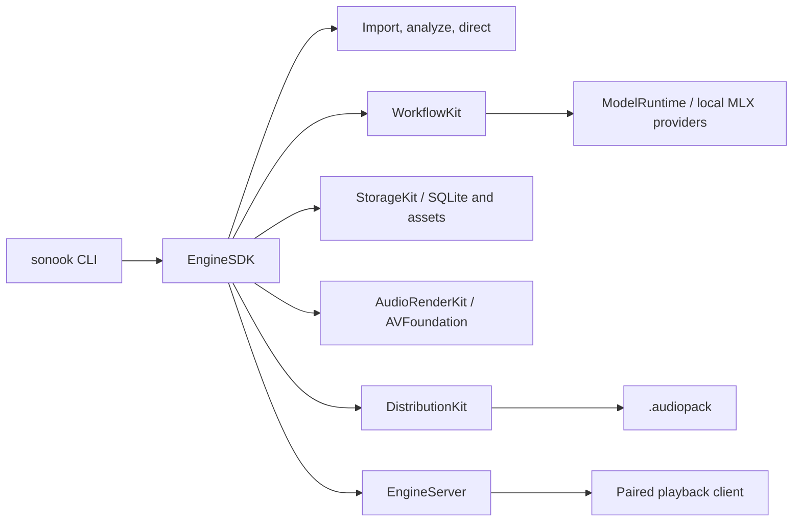

# Sonook CLI（听澜）

[English](README.md)

[](https://github.com/KrakenP/Sonook-CLI/actions/workflows/ci.yml) [](LICENSE)  

在 Mac 终端里，把一份书稿做成多人演播的有声书。**Sonook CLI（`sonook`）** 是为 Apple Silicon 开发的本地优先 Swift 原生音频命令行工具与音频引擎。每句录音都能找到对应的原文、说话人和质检结果。听到某句需要重录时，可以只重做这一句，保留其他已验收的录音。

## 可以做什么

- **原文保真有声书**。导入 TXT、Markdown 或 EPUB，为每个角色固定声线，用本地 ASR 回听质检，导出带章节标记的 M4B，也支持 M4A 和 WAV。
- **剧情音景**。按场景铺环境音，把拟音对齐到具体片段。混音时给对白留出空间，保留干声，方便后续调整。
- **授权广播剧**。为项目显式授权后，将对白和叙述改编成剧本。改编后的片段仍能按字节范围追溯原文。
- **私人播客**。导入本地笔记，制作单人讲述或双人对谈的节目。脚本中的陈述和推断都可以回到引用片段核对。
- **离线分发与同步**。把成品发布为可逐章读取的 `.audiopack`。本机回环服务支持配对、断点下载、播放进度同步，也能把上下文问答限制在听众已经听过的范围内。



CLI 与 Swift 客户端调用同一套应用服务。AudioCore 定义共享契约，ModelRuntime 分阶段加载模型，WorkflowKit 在片段之间保存检查点。[技术架构](ARCHITECTURE.md)

## Apple Silicon 实测

测试机为 Apple M5 Max，配备 64 GiB 统一内存。RTF 是合成耗时与生成音频时长之比。表中的百章压测使用测试音频，测量任务调度、持久化和恢复时间。

| 测试场景 | 实测结果 |
|---|---|
| VoxCPM2-8bit 锁定参考音色，48 kHz，20 段 | 稳态 RTF **0.219**，约为实时速度的 **4.57 倍**。MLX 峰值 **7.46 GiB**，进程物理内存峰值 **9.50 GiB**。[P0 基准](Benchmarks/p0-baseline.md) |
| 真机 GPU 连续制作 5 章、97 段 | RTF **0.21–0.24**。分阶段进程物理内存峰值为 Qwen3.5-9B **5,623 MiB**、VoiceDesign **10,784 MiB**、VoxCPM2 **10,332 MiB**、ASR **4,305 MiB**。[长篇验收](docs/adr/0004-p3-long-form-reliability.md) |
| GPU 推理中收到 `SIGKILL` 后恢复 | 新进程跳过全部 **8** 个已提交检查点。缺失、损坏、孤立资产均为 **0**。[强制退出与恢复记录](docs/adr/0004-p3-long-form-reliability.md) |
| 100 章、1,500 段，注入 4 次瞬时故障 | 共 **2.070 秒**，含完成 400 个检查点后的取消和重新打开工作区。1,500 个 WAV 的哈希全部通过校验。[压力测试](docs/adr/0004-p3-long-form-reliability.md) |
| 已记录的测试基线 | 11 个测试目标共 **175 项单元测试**，另通过 **8 项**真实回环客户端联调。[P5 验收](docs/adr/0006-p5-server-distribution-and-sync.md) |

## 安装并制作第一章

需要 Apple Silicon Mac、macOS 14 或更高版本，以及提供 Swift 6.3 或更高版本和 Metal Toolchain 的完整 Xcode。进入 **1.0 发行版源码根目录**执行以下命令。首次构建时，SwiftPM 会获取锁定版本的依赖。

```sh
git clone https://github.com/KrakenP/Sonook-CLI.git
cd Sonook-CLI
xcodebuild -downloadComponent MetalToolchain
./scripts/install.sh
export PATH="$HOME/.local/bin:$PATH"
sonook --version
sonook doctor
```

把上面的 PATH 设置加入 shell 启动文件，新终端就能找到 `sonook`。默认安装前缀为 `~/.local`，也可以用 `./scripts/install.sh --prefix <目录>` 指定位置。卸载时运行 `./scripts/uninstall.sh`，使用与安装相同的前缀。常规卸载会保留工作区、导出文件和本地权重。

在开发分支上，也可以运行 `swift build -c release` 和 `export PATH="$PWD/.build/release:$PATH"`，直接使用源码目录中的 CLI。尚未包含安装脚本的版本也能使用下方的分步制作命令。

自行下载四个阶段所需的 MLX 兼容权重，把下面的路径替换为机器上的实际目录。各目录应包含模型配置、相应 Provider 需要的分词器文件和权重。注册后，引擎在工作区记录这些路径。[模型来源与许可](docs/THIRD_PARTY_LICENSES.md)

```sh
models="$HOME/Models"
sonook model register --id story --kind llm --provider mlx-swift-lm --path "$models/Qwen3.5-9B-4bit"
sonook model register --id audition --kind tts --provider qwen3-tts-voice-design --path "$models/Qwen3-TTS-12Hz-1.7B-VoiceDesign-bf16"
sonook model register --id voice --kind tts --provider voxcpm2-mlx --path "$models/VoxCPM2-8bit"
sonook model register --id listen --kind asr --provider qwen3-asr-mlx --path "$models/Qwen3-ASR-1.7B"
sonook model list
```

直接把任意 TXT、Markdown 或 EPUB 文件传给 `sonook`，它会在原文所在目录创建 `<书名>_sonook/` 文件夹，按五阶段实时显示本地模型进度，并在完成后把有声书、时间轴、角色声卡和质检报告直接放进该文件夹。

```sh
sonook Tests/AudioCoreTests/Fixtures/p0-unit-sample.txt
```

也可以按需追加章节、格式或发行包参数，或用 `sonook build` 将成品统一放进 `~/Sonook` 工作区：

```sh
book=Tests/AudioCoreTests/Fixtures/p0-unit-sample.txt
sonook "$book" --chapters 1 --format m4b --publish
sonook build "$book" --name "Ferry Bells" --chapters 1 --format m4b --publish
```

完成后会打印输出目录和成品路径。如果质检拦下某句，可查看文件夹里的 `verify-report.json` 并按提示只重录或放行该片段。任务中断后，用 `sonook job resume <job-id>` 从检查点续跑。

### 分步制作

如果想在合成前检查剧本，可以单独新建一个项目，逐步执行。示例用 Python 3 从 JSON 中取出 ID，也可以从 CLI 输出中手动复制。

```sh
book=Tests/AudioCoreTests/Fixtures/p0-unit-sample.txt
project=$(sonook project create --name "Ferry Studio" --json | python3 -c 'import json,sys; print(json.load(sys.stdin)["project_id"])')
sonook import "$book" --project "$project"
sonook chapter list --project "$project"
sonook analyze --project "$project" --chapters 1 --llm story
sonook script show --project "$project"
sonook generate --project "$project" --chapters 1 --audition-tts audition --main-tts voice --asr listen --run
sonook review list --project "$project" --chapters 1
sonook verify --project "$project" --chapters 1 --save-report
```

如果有片段待审核，可以用 `sonook segment regenerate <segment-id> --project "$project"` 单独重录。试听后决定接受的片段，可用 `sonook segment approve <segment-id> --project "$project" --note "已试听确认"` 留下审核记录。重新验证通过后即可导出。

```sh
sonook export --project "$project" --chapters 1 --format m4b
sonook project path "$project"
```

### 到哪里找成品

```text
~/Sonook/
├── sonook.sqlite
├── assets/<kind>/<sha256>.<ext>
├── .tmp/
└── outputs/<title>__<project-id>/
    ├── audiobooks/
    ├── characters/
    ├── reports/
    └── releases/
```

数据库保存项目、模型注册记录和任务状态。按内容哈希保存的内部资产包含私有制作素材。项目输出目录里有可收听的成品与时间轴、人物卡、审核报告和带版本的发行包。可以通过 `--workspace <目录>` 或环境变量 `SONOOK_WORKSPACE` 更换工作区。

## 在本机发布并连接播放器

用上面的项目发布已经通过质检的章节，然后校验发行包。`publish` 将目录写入本机并登记在发行清单中。在同一工作区启动服务。

```sh
pack=$(sonook publish --project "$project" --chapters 1 --json | python3 -c 'import json,sys; print(json.load(sys.stdin)["output_path"])')
sonook pack verify "$pack" --json
sonook releases list --project "$project"
sonook serve
```

保持服务运行，在第二个终端检查服务状态并生成配对码。

```sh
curl -fsS http://127.0.0.1:8765/v1/health
sonook server pair-code --scopes catalog:read,media:download,playback:sync --json
```

播放器将挑战 ID、配对码和设备名称发给 `POST /v1/pair/confirm`，随后用返回的 Bearer 令牌读取发行清单、通过 HTTP Range 分章下载，并提交离线期间的播放事件。运行 `sonook server devices` 可查看配对设备，用 `sonook server revoke <device-id>` 可撤销访问。[开放格式与客户端协议](docs/specs/audiopack-v1.md) · [安全与漏洞报告](SECURITY.md)

## 项目文档

[路线图](ROADMAP.md) · [版本说明](CHANGELOG.md) · [贡献与测试](CONTRIBUTING.md) · [第三方及模型许可](docs/THIRD_PARTY_LICENSES.md) · [Apache-2.0 许可证](LICENSE)
